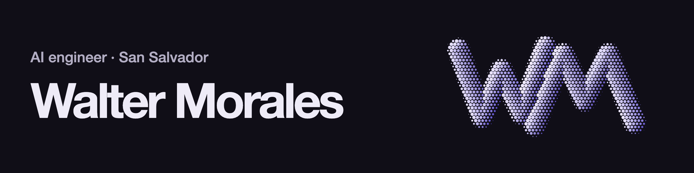

I build AI products for teams across Latin America. Most projects start with a workflow someone already knows by heart. I connect an agent to the tools they use, then build evaluations around the decisions they need to trust.

<a href="https://wmorales.dev/en"><strong>Explore my work ↗</strong></a> &nbsp; · &nbsp; <a href="https://wmorales.dev/en/book">Book a call</a> &nbsp; · &nbsp; <a href="https://linkedin.com/in/wmoralesdev">LinkedIn</a>

<h2>What I’m building</h2>

<h3><a href="https://ailabs.sv/">Ai Labs</a> · Co-Founder</h3>

I co-founded Ai Labs in San Salvador to help teams put AI to use in their day-to-day operations. We build around the tools they already have, whether they’re preparing quotes, tracking inventory, or following up with customers. Then we train the people who will run the software.

<h3><a href="https://mediconecto.com/">MediConecto</a> · Founder</h3>

I built MediConecto around a familiar problem in El Salvador. Finding a doctor who takes your insurance can mean an afternoon on the phone. Patients can now search by specialty, city, or insurance and book online for free. Clinics can manage their schedules and patient records in the same product.

<h2>Developer community</h2>

I organize Cafe Cursor meetups and hackathons in El Salvador and teach hands-on workshops in Spanish and English. What started around coding tools has grown into a community of <strong>1,000+ builders</strong>. Across <strong>75+ events</strong>, we’ve welcomed <strong>3,000+ distinct attendees</strong>.

<h3>Ambassador roles</h3>

<ul>
  <li><strong>Build and Bot Ambassadors Regional Lead</strong></li>
  <li>Codex Ambassador</li>
  <li>Cognition Ambassador</li>
  <li>Mistral Ambassador</li>
</ul>

<a href="https://photos.app.goo.gl/qNSHWVYZwThjrUuY9">Cursor Hackathon II photos ↗</a> &nbsp; · &nbsp; <a href="https://photos.app.goo.gl/X4gF3SAVKAG665gb9">Cafe Cursor III photos ↗</a>

<h2>On the engineering side</h2>

I’ve spent more than six years building software. My stack is TypeScript, Next.js, React, and .NET, with PostgreSQL on AWS or Azure. These days I spend much of my time integrating models into existing products, connecting agents to data through MCP, and helping engineers review and test code written with Codex, Cursor, and Claude Code.

<a href="mailto:hello@wmorales.dev">hello@wmorales.dev</a> &nbsp; · &nbsp; <a href="https://wmorales.dev/">Sitio en español ↗</a>

